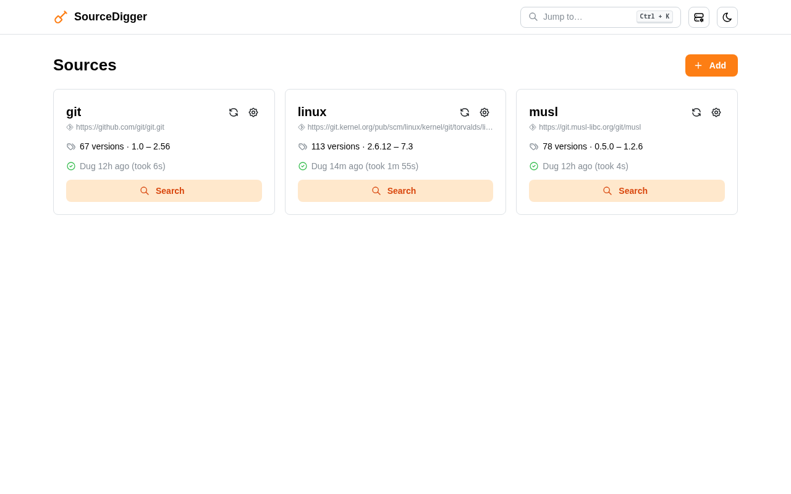
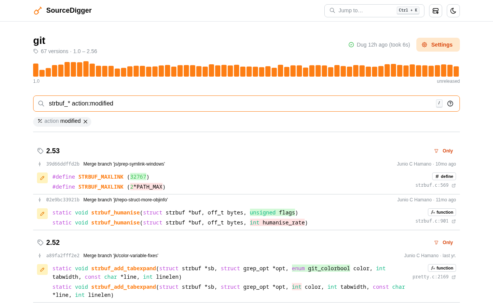
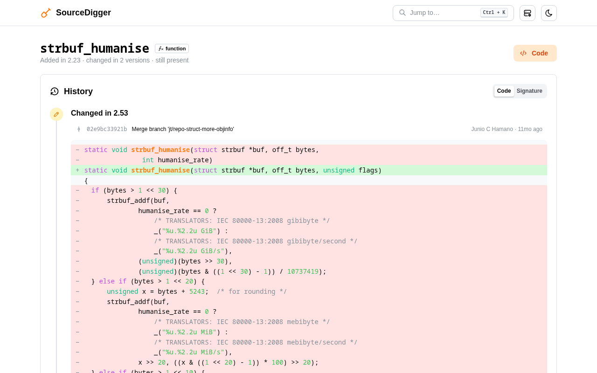
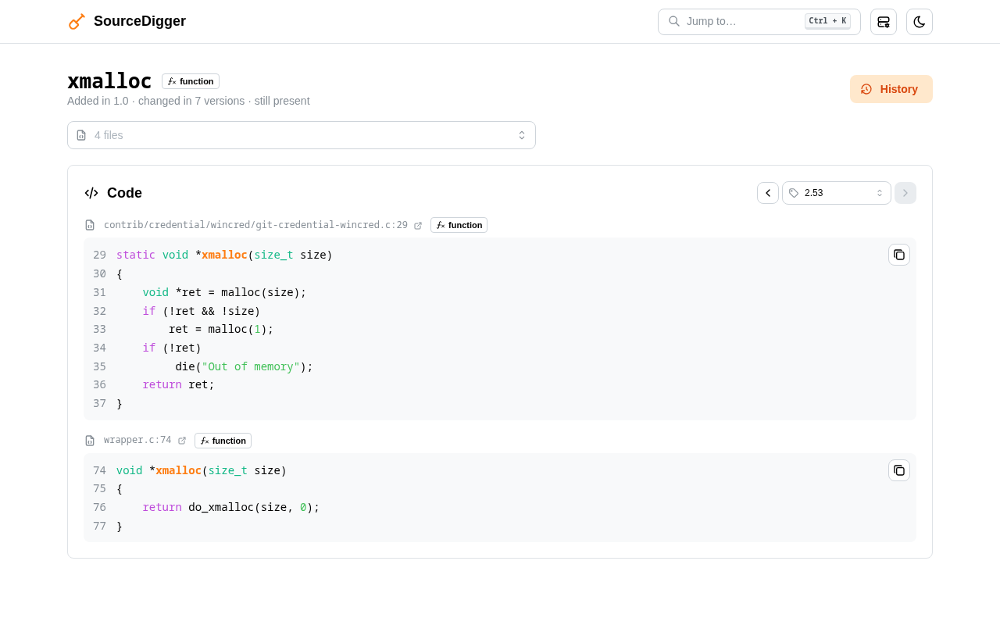

# SourceDigger

Browse the symbols of big C projects across their history: for every version, see which functions, defines,
variables, structs, unions, enums, typedefs and file-scope invocations (`EXPORT_SYMBOL_GPL(foo);`) were added, removed
or changed, and follow one symbol from the version that introduced it to the one that removed it.

A rewrite of [SourceDigger](https://github.com/wazzaps/sourcedigger) by David Shlemayev, who created the idea and the
original sourcedigger.io: a Rust server that indexes git tags with tree-sitter into SQLite, and a React + Mantine web
interface.



Search a source's symbols across versions, merge by merge, with changed signatures marked:



Follow one symbol's history, as code diffs or signature changes, and read its code in any version:





## Quick start on Fedora

```sh
sudo dnf install rust cargo gcc nodejs npm git
npm ci --prefix web
npm run build --prefix web
cargo run --release -- --web-directory web/dist
```

Open http://127.0.0.1:2468, choose **Add source**, and fill in:

| Source | Repository                                                        | Tag pattern                            |
| ------ | ----------------------------------------------------------------- | -------------------------------------- |
| linux  | `https://git.kernel.org/pub/scm/linux/kernel/git/torvalds/linux.git` | `^v(\d+\.\d+(?:\.\d+)?)$`              |
| musl   | `https://git.musl-libc.org/git/musl`                              | `^v(\d+\.\d+\.\d+)$`                   |
| git    | `https://github.com/git/git.git`                                  | `^v(\d+\.\d+)\.0$`                      |
| glibc  | `https://sourceware.org/git/glibc.git`                            | `^glibc-(\d+\.\d+)$`                    |
| vim    | `https://github.com/vim/vim.git`                                  | `^v(\d+\.\d)(?:\.0000)?$`              |

**Preview** shows which tags the pattern turns into versions; the first group of the pattern names the version.
Versions are ordered by their names, so prefer releases from one branch: maintenance tags of older branches (git's
`v2.48.1` after `v2.48.0`) make symbols seem to disappear and come back.
The source viewer is a link template such as `https://elixir.bootlin.com/linux/{tag}/source/{path}#L{line}`.

## Running

Site settings (where the index and the fetched repositories are stored, how many threads parse code, the listen
address) are edited on the **Site settings** page and saved to `~/.config/sourcedigger/settings.toml`; they apply when
the server restarts. Command-line options and environment variables override the file:

```
sourcedigger-server [--settings <path>] [--database <path>] [--repositories <path>] [--threads <count>]
                    [--listen <address>] [--web-directory <path>]
```

- Each option has an environment variable (`SOURCEDIGGER_DATABASE`, `SOURCEDIGGER_THREADS`, …).
- The defaults are `~/.local/share/sourcedigger/` for the index and repositories, every CPU, and `127.0.0.1:2468`.
- There is no authentication: anyone who can reach the server can add, change and delete sources.
- `--web-directory` serves the built web interface; without it only the JSON API under `/api` is served.
- `RUST_LOG=debug` shows more detailed logs.

Repositories are fetched with the `git` command, so private repositories work like they do for `git clone` as the
user running the server: SSH URLs use its SSH keys, agent and `~/.ssh/config`, and HTTPS URLs use its git credential
helper (for example `gh auth setup-git`, or `git config --global credential.helper store` after one `git ls-remote` that
asks for the password). Git never prompts while SourceDigger runs: a missing credential fails the dig with git's
message. For the RPM's service, set these up as the `sourcedigger` user, whose home is `/var/lib/sourcedigger`:

```sh
sudo -u sourcedigger mkdir -m 700 /var/lib/sourcedigger/.ssh
sudo -u sourcedigger ssh-keygen -t ed25519 -N '' -f /var/lib/sourcedigger/.ssh/id_ed25519
sudo -u sourcedigger ssh -T git@github.com
```

The RPM's service keeps everything under `/var/lib/sourcedigger` and listens on `0.0.0.0:2468`; open the port with
`firewall-cmd --add-port=2468/tcp --permanent && firewall-cmd --reload`, and change the address with
`systemctl edit sourcedigger`.

A dig fetches the repository's tags, then indexes each version that isn't indexed yet, so digging again after new
releases only indexes the new versions. A version is indexed merge by merge along the first parent from the previous
version (or commit by commit, for projects without merges), parsing only the files each one changes, so every change
shows the merge or commit that made it. Sources can also be dug automatically every few hours.
When an upgrade changes how the index is stored, the server discards the old index on start and digs every source
again.

## Searching

The query is a regular expression over the whole symbol name: `kmalloc` finds exactly `kmalloc`, `vm_*` finds every
name starting with `vm_` (a bare `*` or `+` means `.*` or `.+`), and `sys_(open|close)` finds both. It is case
insensitive unless it contains an uppercase letter. An empty query lists the latest changes. Press `/` to focus the
search box and `Ctrl+K` to jump to any source or symbol.

Fields narrow the search, and the search box completes them. The API's `events?q=` takes the same text, so a search
page's URL works there too:

| Field | Keeps | Example |
|---|---|---|
| `kind` | `function`, `define`, `variable`, `struct`, `union`, `enum`, `enumerator`, `typedef` or `invocation` | `kind:struct,typedef` |
| `action` | `added`, `removed`, `modified` (the code changed: a body, a struct's fields) or `signature` | `action:signature` |
| `version` | the changes of one version | `version:6.1` |
| `after`, `before` | the changes strictly between two versions | `after:6.0 before:6.3` |
| `path` | changes in files whose path starts with a regular expression | `path:mm/`, `path:drivers/(gpu\|net)/` |
| `commit` | the changes of one merge or commit, by hash or its start | `commit:27bc50fc9064` |

Terms side by side must all match, except that terms of the same field mean any of them, and a `-` or `NOT` before a
term leaves its matches out: `kmalloc* -kmalloc_node* version:6.1 path:mm/ path:include/ -path:mm/kasan/ NOT
kind:define`. `AND`, `OR` and parentheses combine terms further: `(kind:function action:added) OR NOT path:mm/`. `NOT`
binds tightest, then terms side by side, then `AND`, then `OR`. Values with spaces or quotes are quoted, as are names
starting with `(` and names spelled `AND`, `OR` or `NOT`: `path:"my dir/"`. For example, `kmalloc* kind:function version:6.1 path:mm/` lists the `kmalloc`
functions under `mm/` that changed in Linux 6.1.

An invocation is a macro or function called at file scope, indexed under its first identifier argument
(`EXPORT_SYMBOL_GPL(call_rcu)` belongs to `call_rcu`, `module_init(foo_init)` to `foo_init`) or, without one, under its
own name (`MODULE_LICENSE("GPL")`). So a symbol's code in a version lists how it is exported next to its definition,
and `call_rcu kind:invocation` shows when that changed: `EXPORT_SYMBOL` until Linux 2.6.16,
`EXPORT_SYMBOL_GPL_FUTURE` in 2.6.17 and `EXPORT_SYMBOL_GPL` from 2.6.18.

A symbol's page shows its code in every version where it changed, and the diff of each change.

## Limitations

- Only C is read, with tree-sitter and without a preprocessor: every `#if` branch is indexed, macros are not expanded,
  and code tree-sitter cannot parse (such as an `#if` inside an expression) can hide the file-scope definitions after it
  that are indented.
- Function prototypes and `extern` declarations are not indexed, so where a function is declared (in a header) and how
  that declaration changed are not shown.
- Comments are not indexed: neither the documentation above a definition nor license headers such as
  `SPDX-License-Identifier`.
- References are not indexed: there is no list of the callers or users of a symbol.
- Definitions written through a macro, such as `SYSCALL_DEFINE3(open, …) { … }`, are not read as functions; they appear
  as an invocation named after the macro's first identifier argument (`open`).

## API

Everything the web interface shows comes from a JSON API, which also suits scripts and agents. `GET /api` lists every
endpoint with its parameters, the search syntax, kinds, actions and limitations, and `GET /llms.txt` says the same in
Markdown; every page links to it.
[`skills/sourcedigger`](skills/sourcedigger/SKILL.md) is an agent skill with recipes (install it with
`ln -s $PWD/skills/sourcedigger ~/.claude/skills/`). Errors are `{"error": "..."}` with a 4xx or 5xx status. For example, with a `musl`
source:

```sh
curl -s localhost:2468/api/sources/musl/names?q=memc
# ["memchr","memcmp","memcpy","memccpy"]

curl -s 'localhost:2468/api/sources/musl/events?q=memcpy+action:signature'
# {"query": {"q": "memcpy", "kinds": [...], "actions": ["signature"], ...},
#  "events": [{"version": "0.9.5", "action": "signature", "kind": "function", "commit": {"hash": …, "summary": …},
#   "definition": {"signature": "void *memcpy(void *restrict dest, const void *restrict src, size_t n)", ...},
#   "previous": {"signature": "void *memcpy(void *dest, const void *src, size_t n)", ...}, ...}], "next": null}

curl -s 'localhost:2468/api/sources/musl/symbols/memcpy/code?version=1.2.0'
# {"version": "1.2.0", "definitions": [{"path": "src/string/memcpy.c", "line": 5, "end_line": 124,
#   "code": "void *memcpy(void *restrict dest, ...", ...}]}

curl -s localhost:2468/api/sources/musl/symbols/memcpy/revisions | jq '[.[].version]'
# ["0.5.0", "0.9.5", "0.9.13"]
```

`events` pages through results with `cursor=<next>`, and returns how it read the search as `query`.
`revisions` lists every version in which the code of a symbol changed, including changes to its body that leave the
signature alone. A symbol defined in more than 25 files (Linux has `PAGE_SIZE` in 157) needs `path=` on `code` and
`revisions`. `POST /api/sources/<source>/digs?from=scratch` forgets what was dug and digs every version again.

## VS Code

The extension in [`vscode`](vscode) shows a symbol's history when hovering it in a C file: when it was added, how
many versions changed it, and its definitions and exports now. **SourceDigger: History** opens a panel with the diff
of each file in every version it changed in, and **SourceDigger: Compare Versions** diffs its code in a version with
the latest. It finds the source whose repository
is a git remote of the workspace, or asks once. Build it with `npm ci --prefix vscode && npm run package --prefix
vscode` and install `vscode/out/sourcedigger.vsix` with **Extensions: Install from VSIX…**; the server is set with
`sourcedigger.url`.

## Development

```sh
cargo run -- --database /tmp/sourcedigger.sqlite  # the API on port 2468
npm run dev --prefix web                          # the web interface with hot reload, proxying /api
./test.sh                                         # formatting, lints, type checks, tests and the web build
```

## License

[GNU Affero General Public License v3.0](LICENSE), like the original SourceDigger by David Shlemayev.
